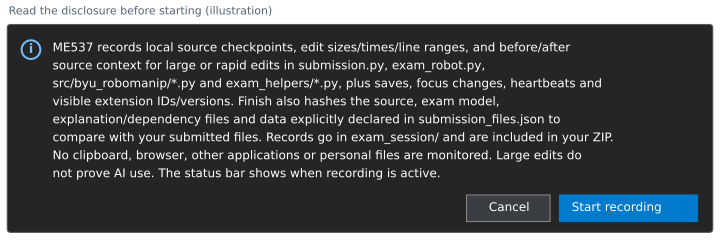

# First: open this README in VS Code's Markdown preview

1. In VS Code, choose **File > Open File...** and select this `README.md`.
2. Click inside the opened file, then use the shortcut for your operating system:

   | Operating system | Open Markdown preview |
   | --- | --- |
   | Windows | **Ctrl+Shift+V** |
   | Linux | **Ctrl+Shift+V** |
   | macOS | **Cmd+Shift+V** |

3. If the shortcut does not work, right-click the file's editor tab and choose
   **Open Preview**. VS Code includes Markdown preview; no extra extension is needed.

These are editor actions, not terminal commands.
[VS Code preview instructions](https://code.visualstudio.com/docs/languages/markdown#_markdown-preview).

# ME 537: pre-exam setup and practice

Use your **own homework library** and the Python virtual
environment you use for homework. This practice includes a visualization of a
two-link arm that follows a fixed table of joint angles. This exercise checks
your environment, editor, viewer, and export.

Follow Steps 1-6 in order. The detailed [OS checklist](OS_CHECKLIST.txt) provides
troubleshooting for Windows, macOS, and Linux. No Docker is required.

Practice uses the exam names with **`_practice` before the file extension or at
the end of the folder name**:

| Purpose | Practice | Actual exam |
| --- | --- | --- |
| Library-check ZIP (Step 2) | `library_check_practice.zip` | `part2_exam_files/library_check.zip` |
| Saved results (Step 5) | `results_practice/` | `part2_exam_files/results/` |
| ZIP to upload (Step 6) | **`exam_practice.zip`** | **`part2_exam_files/exam.zip`** |

The exam keeps its files inside `part2_exam_files/`. The practice commands below
stay the same; run them from your homework repository root.

The library-check ZIP only checks setup. **The Step 6 ZIP is the submission.**

Returning to this exercise? See [Taking a break and restarting VS Code](#taking-a-break-and-restarting-vs-code).

## 1. Prepare your working copy

1. Use **your own homework repository**. You can use this same repository for
   the actual exam after completing the practice cleanup in Step 6.
2. Extract **`practice_files.zip` to `practice_files/` inside your repository**.
   On Windows, right-click the ZIP, choose **Extract All...**, and set the
   destination to `your_repository\practice_files`. On macOS or Linux, extract
   to a folder named `practice_files`, then place it beside `src/`.
   The ZIP contains the files directly, so extraction creates just one tools
   folder. Check that `README.md` is directly inside it:

   ```text
   your_repository/
     src/byu_robomanip/kinematics.py
     practice_files/
       README.md
       check_environment.py
       prepare_vscode.py
       practice_motion.py
       me537-exam-recorder.vsix
       ...
   ```

3. Open a terminal in **`your_repository/`**, the folder containing `src/` and
   `practice_files/`. Run every terminal command below from this folder.
4. Activate the Python virtual environment you use for homework. Throughout this
   guide, `python` means that interpreter; use `python3` instead if that is its
   command on your system. Quote paths that contain spaces.

**You are ready when:** you can see both `src/` and `practice_files/` in your repository and your virtual environment is active.

## 2. Check your Python environment and library

In the terminal, run:

```sh
python practice_files/check_environment.py --repo . --export library_check_practice.zip
```

**Expected:** individual `PASS` messages, then `RESULT: PASS` for the library and
export check. The output shows the interpreter used and the created ZIP's location.

Open **`library_check_practice_summary.txt`** beside the ZIP. It explains the checks and
lists the exported files. This checks loading your library, FK/Jacobian output
shapes, and running the exported library in a fresh Python process. It does not
grade numerical accuracy or check the viewer or recorder yet.

If dependencies are missing, install the supplied numerical requirements into
your virtual environment with the following command in the terminal:

```sh
python -m pip install -r practice_files/requirements.txt
```

Then rerun the previous command to check if it passes.

**Existing output:** keep it and choose a new ZIP name, such as
`--export library_check_2_practice.zip`. Each results folder and export ZIP needs a new name.

## 3. Open the ME537 VS Code environment

In the terminal, run this **single command**:

```sh
python practice_files/prepare_vscode.py --repo . --practice-demo --vsix practice_files/me537-exam-recorder.vsix --launch
```

**Expected:** setup verifies recorder installation and opens a **new ME537 VS Code
window**. Use that window for Steps 4-6.

<details>
<summary>Only if setup cannot find VS Code or the ME537 window does not appear</summary>

Setup checks for `code` on PATH and, on macOS, inside the standard Applications
folders. If VS Code is installed elsewhere, give setup its launcher path.
For a Mac with VS Code in `/Applications`, the complete command is:

```sh
python practice_files/prepare_vscode.py --repo . --practice-demo --vsix practice_files/me537-exam-recorder.vsix --launch --code "/Applications/Visual Studio Code.app/Contents/Resources/app/bin/code"
```

The path ends at the **`code` file inside the app**, rather than the `.app`
folder. Keep the quotes because the path contains spaces. If you need a custom
launcher path, also add the same `--code "PATH"` when reopening or checking this
environment; setup prints a reopening command that includes it.

Alternatively, open VS Code, press **Cmd+Shift+P**, and run
**Shell Command: Install 'code' command in PATH**. Open a new terminal and repeat
the setup command at the start of Step 3.

**On macOS, a launch request is accepted but no window is visible:** press
**Control+Up Arrow** for Mission Control and check the other desktops for the
ME537 workspace. If it is still missing, open **macOS Terminal or iTerm**,
change to your homework repository folder, activate your homework virtual
environment, and run this reopening command:

```sh
python practice_files/prepare_vscode.py --repo . --launch --code "/Applications/Visual Studio Code.app/Contents/Resources/app/bin/code"
```

If your repository path is long, setup prints a shorter macOS VS Code user-data
directory under `~/.me537/`. Keep using the setup command to reopen the same
environment. The workspace, extensions, source files, and recordings remain in
your repository. Practice cleanup removes that generated user data after your
verified export.

Setup reports launcher errors. A successful launch request still needs your
visual check: use the ME537 workspace window and confirm its recorder controls.

</details>

**If VS Code shows Restricted Mode:** click **Restricted Mode** at the bottom
of the window, then click **Trust** for this repository folder. This allows
Python debugging and the ME537 recorder to run. The folder is your local homework
repository containing `src/` and `practice_files/`. If Restricted Mode is not
shown, continue below.

Setup copies the supplied demo file to `exam_helpers/practice_motion.py`. Rerunning
setup preserves an existing copy and its edits. The first setup also installs
Microsoft's Python and Python Debugger tools in this separate environment; it
needs internet access once. Python Run/Debug controls appear when a `.py` file is open.

Setup prints the Python interpreter it selected. Make sure it points to the
**Python interpreter in the virtual environment you use for homework**.
**If the path is correct, continue to Step 4.**

<details>
<summary>Only if the Python interpreter is wrong or Python commands fail</summary>

Use these troubleshooting steps only if needed:

1. Find the Python interpreter in your homework virtual environment. For a
   virtual environment named `.venv`, typical paths are:

   | Operating system | Python interpreter inside the virtual environment |
   | --- | --- |
   | Windows | `.venv\Scripts\python.exe` |
   | Linux | `.venv/bin/python` |
   | macOS | `.venv/bin/python` |

   Your environment may have a different folder name.

   **Only if setup selected the wrong interpreter**, replace
   `PATH_TO_YOUR_VENV_PYTHON` below with the full path to the Python interpreter
   in your virtual environment, then rerun this complete command:

   ```sh
   python practice_files/prepare_vscode.py --repo . --practice-demo --vsix practice_files/me537-exam-recorder.vsix --python "PATH_TO_YOUR_VENV_PYTHON" --launch
   ```

   **If setup printed the correct interpreter path, skip this command** and
   continue to item 2 below.
2. In the **new window**, open the Command Palette with **Ctrl+Shift+P** on
   Windows/Linux or **Cmd+Shift+P** on macOS. Select **Python: Select Interpreter**
   and select the **Python interpreter in your virtual environment**.
3. Close old terminal tabs and choose **Terminal > New Terminal**. Run:

   ```sh
   python -c "import sys; print(sys.executable)"
   ```

   **Expected:** the path points to the Python interpreter in your virtual environment.

If setup or terminal activation fails, see the [OS checklist](OS_CHECKLIST.txt).

</details>

This environment has separate settings/extension storage, built-in AI disabled,
and inline suggestions off. Install only instructor-approved extensions there.
Python packages use the homework virtual environment selected above. Python
packages and VS Code extensions (editor add-ons) are installed separately.

## 4. Start recording and edit your work

**During the actual exam, this is where you will implement the required code**
after starting recording, if required. In this practice, you will only make a
small note/comment edit to rehearse that workflow.

Perform these actions **inside the new ME537 VS Code window**:

The illustrations below show the controls to look for. Your theme and layout may differ.

1. Check the bottom status bar says **ME537 recorder: OFF**.

   

2. Open the Command Palette (**Ctrl+Shift+P** on Windows/Linux;
   **Cmd+Shift+P** on macOS). Type **ME537** to find the recorder commands.

   

3. Select **ME537: Start Disclosed Exam Session** and read the disclosure.

   

   Choose **Start recording** to accept. **Expected:** the status changes to **ON**.
   Recording starts only after consent.

   

4. Open **`exam_helpers/practice_motion.py`**. Change **`PRACTICE_NOTE`** to describe
   this OS test, type a small comment, and save the file. The supplied motion is
   complete; only the note/comment needs editing.

**Save your edit, then continue to Step 5.** In the actual exam, you will use
Step 5 to run and test the code you implemented here. You must keep the recording active
through implementation and testing; only stop it when you finish in Step 6.

These are Command Palette actions, not terminal commands. If the commands or
status bar are missing, stop here and follow the OS checklist's recorder troubleshooting.

### Taking a break and restarting VS Code

**Breaks and restarts are allowed during practice and Part 2.** Use the same
working copy each time, keeping its `exam_session/` folder in place.

1. **Before a planned break:** save all files, then open the Command Palette
   (**Ctrl+Shift+P** on Windows/Linux; **Cmd+Shift+P** on macOS) and select
   **ME537: Finish Session**. Check **FINISHED**, then close the ME537 window.
   You can start another recording when you return.
2. **To reopen:** open a terminal in the **same repository root**, activate
   your homework virtual environment, and run:

   ```sh
   python practice_files/prepare_vscode.py --repo . --launch
   ```

3. **Before continuing any edits:** the reopened recorder starts **OFF**.
   In the new ME537 window, open the Command Palette and select
   **ME537: Start Disclosed Exam Session**. Accept the disclosure and check
   **ON**, then continue your work in Steps 4-5.

Each start adds a new recording segment. Earlier saved events and snapshots
are kept and included together in your final ZIP. Reopening the window does
not start recording automatically. Finish the last recording before exporting
in Step 6.

**If the window closes unexpectedly:** reopen it with the command above and
start recording again before editing. Keep the existing `exam_session/` folder;
earlier saved records remain available for instructor review. You can resume
even if you did not select Finish Session before the window closed.


## 5. Run and review the saved motion

In a terminal in the prepared window, run:

```sh
python exam_helpers/practice_motion.py --output results_practice
```

**If the output folder already exists:** either delete that folder and its
contents if you no longer need them, or change the folder name after `--output`
to a new one, such as `--output results_2_practice`. Keep any other command options
the same. If you change the results folder, use that new folder in the file paths
below and in Step 6's `--demo-results` option.

**Expected:** the two-link arm moves for about six seconds. Wait for **Motion
complete**, then close the viewer. Inspect these files in `results_practice/`:

| File | What to check |
| --- | --- |
| `preview.png` | A clear picture of the arm |
| `practice_report.json` | `graphics.status` is `completed`; `frames_rendered` is `121` |
| `trajectory.npy` | Saved joint data for replay |
| `joint_angles.csv` | Readable time and joint-angle values |

You can continue directly to Step 6 after the motion completes. To **optionally
view the saved motion again**, run:

```sh
python exam_helpers/practice_motion.py --trajectory results_practice/trajectory.npy
```

This only displays the saved joint angles. It creates no results folder and
does not change the saved output. Omit `--output` when replaying.

If graphics dependencies are missing, use
`practice_files/requirements-graphics.txt`. `--no-gui` is for diagnosis and does
not count as a graphics pass.

## 6. Finish recording and export your ZIP

1. **Save your edited files.**
2. Select **ME537: Finish Session**. **Expected:** the status says **FINISHED**.
3. Export from a terminal in your repository root. The arguments mean:

   | Argument | What it selects |
   | --- | --- |
   | `--repo .` | Your homework repository; `.` means the current folder |
   | `--export NAME.zip` | The new ZIP file to create; choose a name that does not already exist |
   | `--demo-results FOLDER` | The results folder you created in Step 5 |
   | `--require-session` | Require a finished recording to be included; this flag has no value after it |

   **Example:** if Step 5 saved results in **`results_practice/`**, create a ZIP
   named **`exam_practice.zip`** with:

   ```sh
   python practice_files/check_environment.py --repo . --export exam_practice.zip --demo-results results_practice --require-session
   ```

4. Open **`exam_practice_summary.txt`** and check:
   - The library export passed its fresh-process check.
   - The included animation report says `completed`.
   - The included recorder session says `finished`.
   - The final recording/source comparison says **`MATCH`**.
5. Check the summary's included-file list for your library, practice source,
   saved motion, preview, reports, and recording files. The exporter includes
   the session log automatically for your instructor; **you do not need to open
   or inspect it**.
6. **The File `exam_practice.zip` is your practice deliverable.**
   Keep the ZIP and summary for troubleshooting. For the actual exam, follow a similar readme to this one to create and upload your completed exam ZIP.
7. **When finished, clean up practice.** Close the
   ME537 VS Code window, open a regular terminal in this repository, activate
   your virtual environment, and run:

   ```sh
   python practice_files/cleanup_practice.py --repo . --archive exam_practice.zip --apply
   ```

   `--archive` names the practice ZIP to keep as your backup; use your actual
   ZIP name if you changed it. `--apply` removes verified practice files; omit
   it to preview the cleanup first. Cleanup removes the exported practice
   results, demo, recording, preliminary library-check ZIPs/summaries, and the
   generated VS Code profile. It keeps **`exam_practice.zip`**, its summary,
   **`practice_files/`**, and your homework/library files. Changed or unexported
   recording files stop cleanup so you can export again first.

   **After cleanup finishes, you can reuse this repository and virtual environment
   for the actual exam. This is the main reason to run the cleanup script!** Keep the practice ZIP and summary as your backup.
   Follow the exam README to start a new recording for the exam.

The export uses the saved trajectory for instructor playback. It does not rerun
the viewer or prove complete recording. If a comparison flags changed, added,
missing, or unverifiable files, preserve the records and report the discrepancy.
If you need to edit after finishing, start a **new disclosed session before
editing**, then finish again and export to a new ZIP name.

## What recording and export collect

During a session, the recorder saves source-code copies, edit/save times and
sizes, session activity, VS Code focus changes, and extension information in
`exam_session/`. Finishing records file fingerprints so your final recorded
files can be compared with the files you submit.

The export automatically bundles your library, practice source, saved motion,
preview, environment reports, and recording files for your instructor's review.

Report setup problems **by October 24** and preserve the reports and session
records. The exam window is **October 19-26, 2026**.
